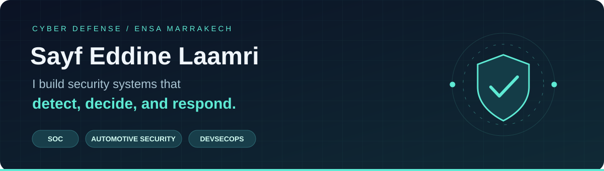

<strong>Cybersecurity Engineering Student · SOC & Incident Response · DevSecOps</strong> ENSA Marrakech · Morocco

---

## 👋 About me

I study **Cyber Defense & Embedded Telecommunications Systems at ENSA Marrakech**. I build practical security workflows across **detection, incident response, AI-assisted decision support, and infrastructure automation**.

My cybersecurity internships at **Capgemini Engineering** and **ABHT** gave me hands-on experience with automotive malware decision workflows and Suricata–Wazuh monitoring.

🎯 **Seeking a final-year cybersecurity internship (PFE) from February 2027**, focused on SOC engineering, detection, incident response, or DevSecOps.

## 🚀 Featured projects

<table>
<tr>
<td width="50%" valign="top">
<h3>🛡️ IVI Guard</h3>
<strong>Automotive malware decision support</strong>

n8n prototype evaluating 13 simulated scenarios with constrained recommendations, deterministic validation, and human review. No vehicle countermeasures are executed.

  

<a href="https://github.com/laamri/IVI-Guard"><strong>Explore the project →</strong></a>
</td>
<td width="50%" valign="top">
<h3>🔎 Suricata + Wazuh SOC Lab</h3>
<strong>Detection and response · ABHT internship</strong>

IDS/IPS integration, event correlation, threat-intelligence enrichment, and active-response scripts. Includes documentation and demonstrations.

  

<a href="https://github.com/laamri/projet_stage_observation"><strong>Explore the project →</strong></a>
</td>
</tr>
<tr>
<td width="50%" valign="top">
<h3>⚙️ Next-Gen DevSecOps</h3>
<strong>Natural language → CI/CD and infrastructure</strong>

Team-built platform generating and validating delivery artifacts, integrating security scanning and Terraform planning. Co-developed with Bagy Oussama.

  

<a href="https://github.com/laamri/next-gen_devsecops"><strong>Explore the project →</strong></a>
</td>
<td width="50%" valign="top">
<h3>📱 MobileSec</h3>
<strong>Android authentication and session security</strong>

Collaborative analysis toolkit combining static analysis, API testing, session checks, and structured reports. Upstream attribution and evaluation are documented in the repository.

  

<a href="https://github.com/laamri/MobileSec"><strong>Explore the project →</strong></a>
</td>
</tr>
<tr>
<td width="50%" valign="top">
<h3>🕸️ Cyber Chaos Arena</h3>
<strong>Honeypots, runtime detection and observability</strong>

Public subset of a team SOC lab with containerized honeypots, centralized telemetry, and investigation tools.

  

<a href="https://github.com/laamri/Cyber-Chaos-Arena"><strong>Explore the project →</strong></a>
</td>
<td width="50%" valign="top">
<h3>🐍 PenAut</h3>
<strong>Python reconnaissance toolkit</strong>

Collaborative toolkit bringing together common penetration-testing utilities for scanning, enumeration, and investigation.

  

<a href="https://github.com/laamri/PenAut"><strong>Explore the project →</strong></a>
</td>
</tr>
</table>

## 🧰 Technology stack

### Cloud & DevSecOps

### Development & automation

### Security & observability

      

<strong>🔬 Explore my skills by domain</strong>

| Area | Tools and skills |
| --- | --- |
| **SOC & detection** | Wazuh, Suricata, Falco, ELK, alert correlation, file-integrity monitoring |
| **Response & automation** | Python, Bash, PowerShell, n8n, threat-intelligence APIs, validated AI recommendations |
| **Cloud & DevSecOps** | Docker, Kubernetes, Terraform, Ansible, Jenkins, AWS, Trivy |
| **Security assessment** | Burp Suite, Nmap, Metasploit, Wireshark, Android authentication and session analysis |
| **Forensics & reverse engineering** | Autopsy, Volatility, Ghidra, JADX |
| **Development & data** | Python, C, Java, JavaScript, SQL, FastAPI, React, Kafka, Spark |
| **Infrastructure & monitoring** | Grafana, Prometheus, Zabbix, VMware, Proxmox, VLANs, VPNs |

## 💼 Experience

| | Experience |
| --- | --- |
| **🚗 Capgemini Engineering** | **Cybersecurity Intern · Jul–Aug 2026 · Casablanca** Designed a workflow for simulated automotive malware scenarios, combining contextualization, decision support, validation, and evaluation. |
| **🌊 ABHT** | **Information Security Intern · Jul–Aug 2025 · Marrakech** Deployed Suricata and Wazuh for intrusion detection and monitoring; contributed to infrastructure security audits and risk analysis. |

## 🏆 CTF & continuous learning

- **0ops team results:** 1st at AISEC International; 2nd at Knights of the Fury and GCDxN7, as listed in my CV.
- **Community:** active member of the GCDSTE cybersecurity club.
- **Training:** Cisco Network Basics, TryHackMe, and Practical IoT Security & Penetration Testing.
- **Practice:** [Android security labs](https://github.com/laamri/Securite_des_applications_mobiles).

---

<strong>Let's build better security.</strong> Available for PFE opportunities from February 2027.

